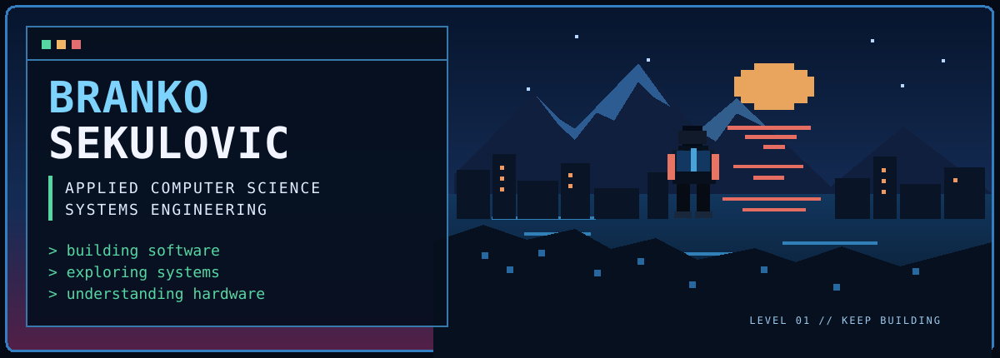
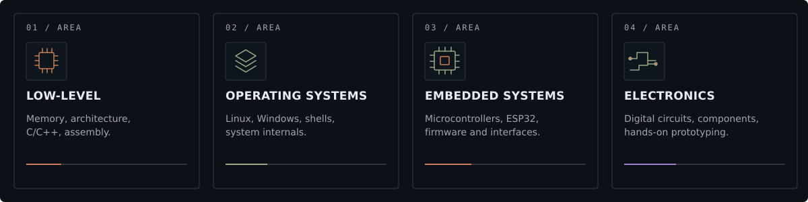

  
  
  

<table>
<tr>
<td width="58%" valign="center">

### `OVERVIEW`

I'm a software developer focused on understanding how computing systems work, from low-level programming and computer architecture to operating systems, embedded devices, and the interaction between hardware and software.

I learn by building practical projects, investigating how things behave, and debugging problems until I understand their underlying causes.

**Build. Investigate. Understand. Improve.**

</td>
<td width="42%" valign="center">

### `TECHNICAL FOCUS`

- **Low-level programming** · C, C++, assembly
- **Operating systems** · Linux, Windows, shells
- **Embedded engineering** · ESP32, firmware
- **Electronics** · circuits, components, hardware

</td>
</tr>
</table>

## `TECHNOLOGY STACK` languages, platforms & tools

**LANGUAGES & RUNTIME**

**SYSTEMS & DEVELOPMENT TOOLS**

---

## `CONTRIBUTIONS` GitHub activity

BRANKO SEKULOVIC · SOFTWARE · SYSTEMS · HARDWARE

