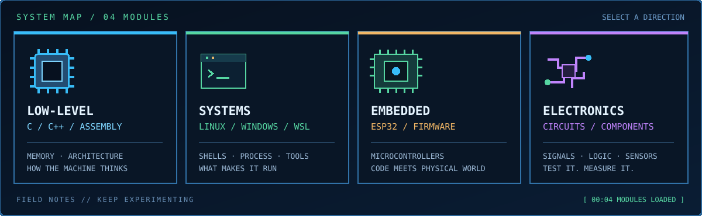

 

<table>
<tr>
<td width="56%" valign="top">

### `PLAYER PROFILE`

I'm a software developer interested in what happens beneath the surface: low-level programming, computer architecture, operating systems, embedded devices, and the relationship between hardware and software.

**Build it. Break it. Debug it. Understand it.**

</td>
<td width="44%" valign="top">

### `ACTIVE QUESTS`

</td>
</tr>
</table>

## `LOADOUT` tools in the inventory

**LANGUAGES & RUNTIME**

**SYSTEMS & WORKFLOW**

## `SIGNAL FEED` contribution map

The contribution animation is generated automatically by this repository's GitHub Actions workflow.

<table>
<tr>
<td width="70%" valign="center">

### `DESIGN PHILOSOPHY`

**Understand the system. Build the solution.**

</td>
<td width="30%" align="right" valign="center">

</td>
</tr>
</table>

BRANKO SEKULOVIC · BUILT WITH CURIOSITY, DEBUGGED WITH PATIENCE

