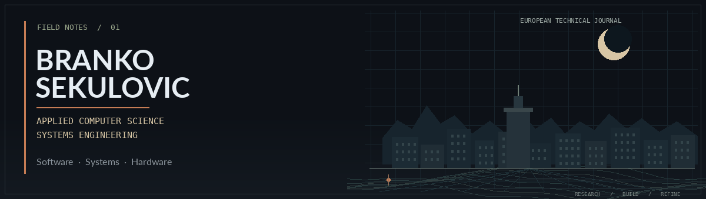

  
  
  

<table>
<tr>
<td width="58%" valign="top">

### OVERVIEW

I’m a software developer interested in how computing systems work, from low-level programming and computer architecture to operating systems, embedded devices, and the relationship between hardware and software.

I prefer practical learning: building, inspecting, debugging, and understanding why a system behaves the way it does.

</td>
<td width="42%" valign="top">

### CURRENT INTERESTS

**Electronics engineering**
Circuit design, PCB design, digital logic and hardware interfaces.

**Networking engineering**
TCP/IP, network protocols, sockets and packet analysis.

**Reverse engineering**
Binary analysis, disassembly, debugging and executable formats.

**Compiler development**
Lexers, parsers, interpreters, compilers and LLVM.

ㅤㅤ
ㅤ
</td>
</tr>
</table>

## TECHNOLOGY

LANGUAGES

PLATFORMS & TOOLING

---

## ACTIVITY

<table>
<tr>
<td width="70%" valign="center">

### ENGINEERING APPROACH

Understand the system. Build the solution. Improve it through evidence and iteration.

</td>
<td width="30%" align="right" valign="center">

</td>
</tr>
</table>

BRANKO SEKULOVIC · SOFTWARE / SYSTEMS / HARDWARE

